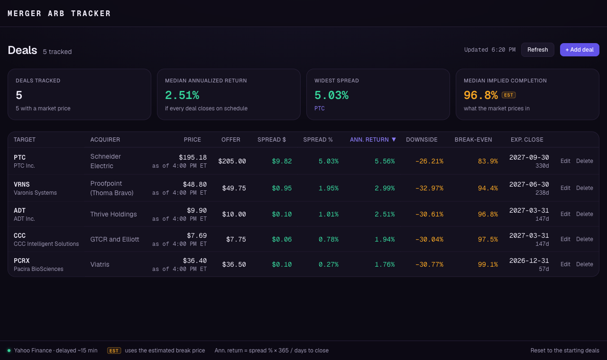
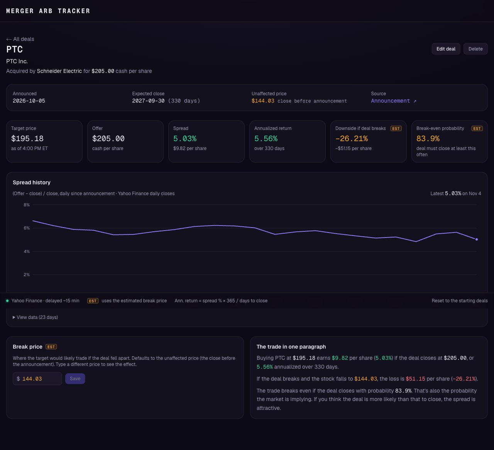

# Merger Arbitrage Tracker

A dashboard for tracking announced **all-cash M&A deals** the way an event-driven fund would: how wide is the spread, what's the annualized return if the deal closes, what do you lose if it breaks, and how likely does the market think completion is? It can also track rumoured deals reported by the press, kept separate and clearly labelled as unconfirmed.

**Live demo: https://merger-arbitrage-tracker.vercel.app**



## Features

- **Deal dashboard.** A summary strip (median annualized return, widest spread, median implied completion) above a sortable table of target, acquirer, live price, offer, spread ($ and %), annualized return, downside, break-even probability, and expected close. On tablets and phones the table becomes a card list.
- **Deal management.** Add, edit, and delete deals. Typing a ticker checks it against market data, fills in the company name, and suggests a break price.
- **Deal analysis.** A detail page per deal with the metrics above, an editable break price that recalculates live, and a plain-English summary of the trade.
- **Spread history.** A chart of how each deal's spread has moved since announcement, with a table of the underlying data.
- **Real deals only.** Five real pending deals (terms from SEC 8-K filings, each with a source link). Everything the tracker shows is a real deal.
- **Rumoured deals.** A separate section for deals reported by the press but not yet announced, each linked to the original report. Spreads from reported prices are marked as indicative. See [Rumoured deals](#rumoured-deals).



*The detail page: risk/reward ladder, if-it-closes and if-it-breaks cards, spread history, and the break-price what-if.*

## Tech stack

Next.js 16 (App Router) · TypeScript · Tailwind CSS v4 · Recharts · [`yahoo-finance2`](https://github.com/gadicc/yahoo-finance2) · Vitest

No database and no accounts. Deals live in the browser's `localStorage`, seeded from [`data/seed-deals.json`](data/seed-deals.json) on first visit. Prices come from two small API routes (`/api/quotes`, `/api/history`) that call Yahoo Finance on the server and cache the results briefly.

## How the numbers are calculated

All the math is in [`lib/calc.ts`](lib/calc.ts) as pure functions, covered by [`lib/calc.test.ts`](lib/calc.test.ts).

P = current target price · O = cash offer per share · B = break price · d = calendar days to expected close

| Metric | Formula |
|---|---|
| Spread | (O − P) and (O − P) / P |
| Annualized return | (O − P) / P × 365 / d |
| Downside if the deal breaks | (B − P) / P |
| Break-even probability | (P − B) / (O − B) |
| Spread history | (O − close) / close, for each trading day since announcement |

**Break-even probability** is the completion probability `p` at which the trade has zero expected value: `p·O + (1 − p)·B = P`. It's also the probability the market is implying.

**Conventions and edge cases**

- Annualization is simple (not compounded) over calendar days, the usual convention on arb desks.
- Past the expected close date, annualized return shows "—" instead of an exaggerated number.
- A target trading *above* the offer shows a negative spread, and break-even shows "n/a": the market is pricing in a higher bid, so the formula would exceed 100%.
- Break-even is also "n/a" if the break price is at or above the current price.
- Dates are treated as calendar dates, and "today" is the New York market date, so day counts don't shift with the viewer's time zone.
- Any metric that can't be computed shows "—" or "n/a". It never shows NaN or Infinity.

**The break price is an estimate.** By default it's the *unaffected price*: the close on the last trading day before the announcement. When news leaked first, that close already includes the run-up (Varonis would show about −4% downside instead of about −33%), so a deal can carry an optional `unaffectedDate`, the last day before rumors as stated in the company's filing. You can also override the break price outright.

## What's real, what's manual, what's an estimate

| Data | Source | How it's labeled |
|---|---|---|
| Stock prices and history | Yahoo Finance (unofficial, ~15 min delayed) | "as of" time on every price |
| Offer price, announcement date, expected close | Entered by hand from the press release or 8-K | Source link on each real deal |
| Break price and everything derived from it | Estimate | Amber text and an **EST** badge |

Companies guide closing as a window ("Q1 2027"). The seeded deals use the **end** of the window, which never overstates annualized return.

### Seeded real deals (terms as of Nov 4, 2026)

| Target | Acquirer | Offer | Announced |
|---|---|---|---|
| PTC (PTC) | Schneider Electric | $205.00 | Oct 5, 2026 |
| Varonis (VRNS) | Proofpoint / Thoma Bravo | $49.75 | Oct 15, 2026 |
| ADT (ADT) | Thrive Holdings | $10.00 | Oct 29, 2026 |
| CCC Intelligent Solutions (CCC) | GTCR and Elliott | $7.75 | Oct 15, 2026 |
| Pacira BioSciences (PCRX) | Viatris | $36.50 | Oct 8, 2026 |

These are a snapshot, not a live deal feed. Deal terms change (offer increases, extended timelines) and nothing here updates them. Check the linked filing before relying on a number.

## Rumoured deals

Below the announced deals is a separate section for rumoured deals: potential acquisitions reported by the press but not announced by the companies. It is tagged **UNCONFIRMED** and kept out of the summary numbers.

**Accuracy rules**

- **A source is required.** Every rumour links to the report. Any news site is accepted, since rumours surface in many outlets. Well-known outlets (WSJ, Bloomberg, Reuters, FT, CNBC and others) show their short name; any other site shows its own domain and the form notes that it isn't a major outlet, so the credibility check is yours. The publisher is always read from the link, never typed, so the label can't misstate where a report came from (a lookalike such as `reuters.com.evil.io` is labelled with its true domain). Social media, forums and chat sites (Reddit, X, StockTwits, YouTube and similar) are rejected, because a post there isn't a report.
- **Nothing is assumed.** The potential acquirer, a per-share price and a closing timeframe are entered only if the report states them. Anything missing shows as "Not disclosed".
- **Numbers are indicative.** If a report gives a per-share cash price, the spread is calculated against it. It's shown in amber with an **INDICATIVE** tag, because the terms are unconfirmed. Annualized return appears only when the report also gives a timeframe. There's no downside or break-even, since nothing has been agreed.
**Where the rows come from**

| Row | How it gets there | Label |
|---|---|---|
| Shared | Added by Claude on request, after reading a source (any site, filings included), with terms only if the text states them. Ships with the site as `data/seed-rumours.json`, read-only. | none (checked) |
| Auto-found | A headline scan of Yahoo's news search runs when the dashboard opens and on the **Scan for rumours** button. It adds open takeover-talk headlines about one US-listed company, with no terms. Expires after 30 days. Deleting a rumour (of any kind) stops the scan re-adding that company for 30 days. | **AUTO-FOUND** |
| Your own | The **+ Add rumour** form. | none |

Auto-found rows are unverified: the scan reads headlines only. Open the source, and edit the row to confirm it.

**What automatic discovery can and can't do.** The scanner uses only Yahoo's free news search, because the outlets that break rumours don't offer free feeds:

| Source | What's available |
|---|---|
| Bloomberg | No public API (Terminal and B-PIPE are paid). Automated access is blocked and against its terms. |
| WSJ / Dow Jones | Newswires and Factiva are paid. Public RSS has headlines only, and articles are paywalled. |
| Reuters | Public RSS was discontinued in 2020. The news API is paid (LSEG). |
| Yahoo Finance search | Free (via `yahoo-finance2`). Every link is a Yahoo-hosted copy, which is accepted as a source. In a test of 8 deal-talk queries, roughly 3 to 5 of about 80 headlines were usable open rumours about a single company. Headlines naming two companies (acquirer and target) are skipped, because the target can't be told apart, so some real rumours (for example Lionsgate and Instacart) are missed. |

Any source can be used for the **shared** rows, since Claude searches the open web rather than a feed. Paywalled pages (Bloomberg, WSJ, Variety, Deadline) can't be read, so terms from them aren't used.

Even with a feed, pulling terms out of headlines would mean guessing: "$5bn deal" isn't a per-share price, and "exploring a sale" isn't "in talks". That conflicts with the no-fabrication rule, so terms are never read out of a headline: they are entered only from a source that was actually read.

## Known limitations

- **Offer increases and special dividends aren't modeled.** The spread chart uses the current offer for every day.
- **Deal terms are manual.** There's no free API for them.
- **All-cash deals only.** No stock or mixed consideration, and no contingent value rights.
- **Yahoo Finance is unofficial.** It can change or rate-limit without notice. If a price fails to load, the app says so and keeps the last prices it had.
- **Closed deals disappear.** Targets are delisted when a deal closes and lose their price history, so remove a deal once it closes.
- **Deals are saved per browser.** They aren't shared across devices. "Reset to the starting deals" restores the seeded list.

## Getting started

Requires Node.js 22 or newer.

```bash
npm install
npm run dev      # http://localhost:3000
npm test         # unit tests (calculations, form validation, saved deals and rumours, sources)
npm run lint
npm run build
```

No environment variables or API keys are needed. The same is true on Vercel: import the repo and deploy.

## Project structure

```
app/
  page.tsx                 Dashboard
  deals/[id]/page.tsx      Deal detail
  api/quotes/route.ts      Latest prices for a list of tickers
  api/history/route.ts     Daily closes for one ticker
  api/rumours/scan/route.ts  Headline scan for possible rumours (Yahoo news)
lib/
  calc.ts                  All financial math (+ calc.test.ts)
  dealRow.ts               Deal + market data → what the UI shows
  deals.ts                 localStorage store (versioned seed data)
  rumours.ts               localStorage store for rumoured deals (+ shared ones from data/seed-rumours.json)
  rumourScan.ts            Headline classifier for the rumour scan (+ useRumourScan.ts hook)
  sources.ts               Labels a rumour's source link (known outlet or its domain); rejects social media
  validate.ts              Add/edit form validation
  useMarketData.ts         Client hook for live prices
  format.ts                Display formatting (money, percent, as-of time)
components/                DealTable, DealDetail, PayoffLadder, DealForm, SpreadChart,
                           RumourTable, RumourForm, SummaryStrip, StatusBar, Badge,
                           shared UI helpers
data/seed-deals.json       Real deals seeded on first visit
data/seed-rumours.json     Shared rumours (read from sources by Claude, terms only if stated)
```

## Disclaimer

This is a personal project for learning and discussion, not investment advice. Data may be delayed, incomplete, or wrong.
